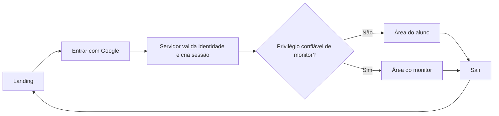

# F2 — Identidade e autorização

Status: planejamento, sem implementação da autenticação. Base: `main` após o [merge do PR #1](https://github.com/filipebteixeira98/meatualiza/pull/1), em 20/10/2026. Escopo e regras de produto permanecem em [ROADMAP.md](./ROADMAP.md) e [INSTRUCTIONS.md](./INSTRUCTIONS.md).

## Resultado esperado

O aluno entra com qualquer conta Google, acessa sua área e pode sair. A conta do monitor recebe uma área distinta e autorização atribuída por procedimento confiável. A separação protege rotas, operações e dados; não depende apenas do menu exibido.

As áreas iniciais mostram a identidade e o estado real dos recursos disponíveis. Calendário, solicitações, métricas, sidebar completa, tour e surveys serão entregues nas fases seguintes. Reutilizar o tema escuro, os componentes e a linguagem da landing; evitar cartões de métricas fictícias e botões sem função.

## Dependências para começar

| Item                  | Situação e próximo passo                                                                                                                                                                                   | Responsável                                   |
| --------------------- | ---------------------------------------------------------------------------------------------------------------------------------------------------------------------------------------------------------- | --------------------------------------------- |
| Projeto Firebase      | Projeto dedicado `meatualiza-monitoria` criado e selecionado no MCP para esta pasta em 20/10, após confirmação do responsável. App web e configuração local reproduzível pendentes.                        | Implementação configura os recursos restantes |
| Conta do monitor      | Confirmada pelo responsável: a mesma conta Google ativa no MCP. Após o primeiro acesso, conferir seu UID antes de atribuir privilégio. O e-mail pessoal não precisa ser versionado no repositório público. | Implementação confere UID e configura         |
| Ambiente              | Registrar app web, habilitar provedor Google e configurar domínios autorizados. Documentar configuração pública e credencial de servidor separadamente.                                                    | Implementação                                 |
| Verificação           | Preparar emuladores e contas de teste. Separar teste de permissões da validação do OAuth real com Google.                                                                                                  | Implementação                                 |
| Acesso a alunos reais | Disponibilizar termos, informações de privacidade e preferências previstos no roadmap antes da abertura. Coleta opcional continua desabilitada até seus controles existirem.                               | Produto e implementação                       |

As escolhas do projeto e da conta estão confirmadas; o projeto está ativo. A implementação da integração real ainda depende da configuração de F2-A e da obtenção do UID do monitor em F2-C. Nenhum privilégio foi concedido nesta preparação.

## Entregas e critérios de aceite

| Ordem / PR                       | Tarefas                                                                                                                                             | Critérios de aceite                                                                                                                                                                                                                                                      | Dependência                           | Esforço relativo |
| -------------------------------- | --------------------------------------------------------------------------------------------------------------------------------------------------- | ------------------------------------------------------------------------------------------------------------------------------------------------------------------------------------------------------------------------------------------------------------------------ | ------------------------------------- | ---------------- |
| F2-A — Preparar Firebase         | F2.0: vincular projeto/app, configurar Google, separar inicialização do navegador e do servidor, documentar variáveis e preparar emuladores/regras. | Configuração reproduzível; credenciais administrativas ausentes do bundle e do Git; configuração ausente gera mensagem clara, sem acesso simulado; acesso direto ao Firestore negado por padrão.                                                                         | Projeto definido e acesso disponível. | Pequeno a médio  |
| F2-B — Entrada e sessão do aluno | F2.1 + parte de F2.3/F2.4: substituir `/entrar`, criar sessão de servidor, persistir perfil mínimo, abrir área do aluno e implementar saída.        | Qualquer conta Google entra sem convite/domínio obrigatório; recarregar mantém sessão válida; novo login não duplica perfil; cancelamento/erro de login permite nova tentativa; saída limpa a sessão; perfil de outro aluno permanece inacessível.                       | F2-A.                                 | Médio            |
| F2-C — Acesso do monitor         | F2.2 + conclusão de F2.3/F2.4: atribuir privilégio por UID em ambiente confiável, abrir área do monitor e validar permissões.                       | Aluno não escolhe nem grava papel de monitor; acesso direto à rota e à operação protegidas é recusado ao aluno; conta correta chega à área do monitor; sessão inválida, expirada ou revogada não autoriza; concessão/remoção de privilégio tem procedimento verificável. | F2-B e UID do monitor confirmado.     | Médio            |

Cada PR inclui os testes do comportamento que introduz, título e descrição em inglês e Conventional Commits. Capturas de desktop e celular acompanham os PRs com mudanças visuais. Nenhuma tarefa de implementação está concluída apenas por constar neste plano.

Não há histórico de velocidade nem disponibilidade de desenvolvimento informada. Os esforços acima servem para ordenar a execução, sem prometer datas ou pontos. Executar uma entrega por vez; quando houver capacidade de calendário definida, reservar cerca de 20% para ajustes e falhas de integração antes de assumir mais escopo.

## Fluxo de acesso proposto

- `/` continua pública. `/entrar` exibe entrada, carregamento, cancelamento e falha; uma sessão válida leva à área correspondente.
- `/aluno` e `/monitor` são destinos iniciais propostos. Ausência de sessão leva ao acesso; tentar uma operação sem autorização é recusado no servidor. Destinos de retorno ficam restritos a caminhos internos permitidos.
- Trocar o ID token do Firebase por cookie de sessão `HttpOnly`, com `Secure` em produção e política `SameSite` adequada. Validar origem/CSRF e autenticação recente na criação da sessão. Não guardar o cookie em armazenamento acessível ao JavaScript.
- Verificar a sessão e a autorização junto a cada leitura/escrita protegida. Verificação de revogação deve rejeitar conta desabilitada ou sessão revogada. Sair encerra a sessão do navegador atual; revogação administrativa é um procedimento distinto.
- Usar uma custom claim `monitor: true`, atribuída somente por Admin SDK em ambiente confiável ao UID confirmado. Ausência da claim em usuário autenticado significa aluno. Não inferir privilégio pelo primeiro cadastro, parâmetro da URL, estado local ou campo editável no perfil.
- Ao conceder privilégio, renovar o token e a sessão. Ao remover privilégio, revogar sessões existentes e exigir novo acesso, evitando que uma claim antiga continue autorizando o monitor.

Essa é a proposta técnica inicial para F2, baseada na documentação oficial; ajustar detalhes durante a implementação se a configuração real exigir, mantendo os critérios de segurança.

## Dados e fronteiras

- Perfil mínimo em `users/{uid}`: nome de exibição, e-mail e datas de criação/atualização. O UID vem da identidade verificada; não do corpo da requisição. Não persistir tokens Google, credenciais administrativas ou papel editável pelo aluno.
- Criar/atualizar o perfil de forma idempotente, preservando sua data de criação. Uma falha de persistência deve permitir nova tentativa sem cadastros duplicados e sem confirmar acesso funcional antes de o perfil necessário existir.
- Proposta de acesso aos dados: navegador usa Firebase Auth; operações da aplicação acessam Firestore pelo servidor. Como o Admin SDK não está sujeito às Security Rules, cada operação de servidor valida identidade, titularidade e privilégio. Regras negam acessos diretos do cliente por padrão.
- Em F2, o aluno consulta somente seu perfil. A área do monitor comprova autorização, sem expor uma listagem de alunos antes de haver necessidade nas funcionalidades da monitoria.
- Autenticação e perfil são dados operacionais. Não ativar Firebase Analytics, PostHog ou Sentry nesta entrega; a instrumentação continua na F7.

## Verificação da entrega

| Cenário                                                            | Resultado esperado                                                                          |
| ------------------------------------------------------------------ | ------------------------------------------------------------------------------------------- |
| Aluno A entra, recarrega e entra novamente                         | Mesma identidade e um perfil; sessão preservada enquanto válida.                            |
| Aluno A tenta ler perfil de B ou acessar operação do monitor       | Recusa no servidor, mesmo sem usar a interface; acesso direto ao Firestore também é negado. |
| Aluno tenta enviar `monitor: true`, outro UID ou papel no cadastro | Nenhum privilégio concedido e nenhum perfil alheio alterado.                                |
| Cookie ausente, alterado, expirado ou revogado                     | Nenhuma operação protegida é autorizada.                                                    |
| Criação de sessão com origem/CSRF inválido ou token inadequado     | Requisição recusada sem criar sessão.                                                       |
| Usuário cancela o Google ou ocorre falha de rede                   | Estado compreensível, foco acessível e nova tentativa sem cadastro duplicado.               |
| Monitor recebe ou perde privilégio                                 | Nova sessão reflete concessão; sessão anterior revogada deixa de autorizar após remoção.    |
| Logout e retorno por URL protegida                                 | Novo acesso exigido; dados protegidos não aparecem por navegação de retorno.                |
| Conta Google real em desktop e celular                             | Entrada e saída verificadas com o provedor, além dos testes com emuladores.                 |

Automatizar os testes de fronteira de autenticação/autorização e os fluxos de navegador sob condições controladas. Emuladores não comprovam sozinhos o funcionamento do Google OAuth real. Em cada PR de implementação, executar formatação, lint, tipagem, build e testes relevantes, registrando o que foi de fato verificado. Avisos de cobrança do GitHub Actions são desconsiderados conforme [INSTRUCTIONS.md](./INSTRUCTIONS.md).

## Próximas entregas após F2

1. **F3:** preparar assuntos, formulário de dúvida e validação. Definir o contrato do pedido vinculado à inscrição, sem criar uma fila de pedidos avulsos.
2. **F4:** entregar o fluxo aluno → sessão disponível → assunto/dúvida → inscrição confirmada. Salvar pedido e inscrição juntos, respeitando dez vagas, unicidade, prazos e concorrência. Incluir cancelamento e remarcação consistentes.
3. **F5:** completar painéis e navegação; mostrar ao monitor quantidade prevista por sessão, inscritos e dúvidas. Acrescentar presença, realização, avaliação pelo aluno e métricas com definições aprovadas.
4. **F6–F8:** tour dos recursos existentes, feedback e observabilidade com preferências, validação final e publicação.

Melhorias de UX a incorporar nas respectivas entregas: entrada com uma ação principal; mensagens claras de falha; nenhuma escolha de perfil; lista de sessões como alternativa ao calendário em celular; explicações curtas junto às regras de vagas e prazo. Continuam fora do escopo chat, anexos, lista de espera e notificações externas.

## Referências técnicas consultadas

Consultadas via Context7 em 20/10/2026:

- [Firebase: cookies de sessão](https://firebase.google.com/docs/auth/admin/manage-cookies).
- [Firebase: custom claims e autorização](https://firebase.google.com/docs/auth/admin/custom-claims).
- [Firebase Admin SDK: atribuição de custom claims](https://firebase.google.com/docs/reference/admin/node/firebase-admin.auth.baseauth#setcustomuserclaims).
