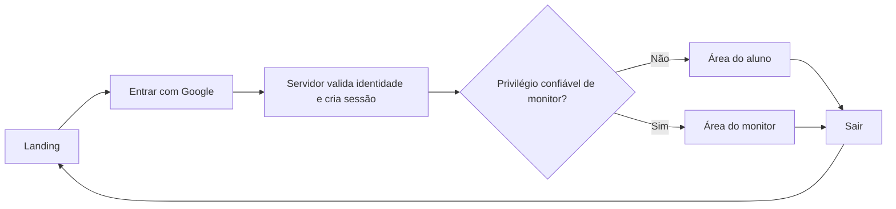

# F2 — Identidade e autorização

Status: F2-A integrada à `main` no [PR #3](https://github.com/filipebteixeira98/meatualiza/pull/3), em 21/10/2026. F2-B está implementada nesta branch para revisão, com sessão, perfil, entrada e saída verificados nos emuladores. Ambiente privado e ADC preparados; em 22/10/2026, o responsável confirmou entrada Google real e redirecionamento após sincronizar o relógio por NTP. B.6 permanece em validação nos demais cenários; F2-C está refinada abaixo para execução após concluir B.6 e integrar o PR #5. Escopo e regras de produto permanecem em [ROADMAP.md](./ROADMAP.md) e [INSTRUCTIONS.md](./INSTRUCTIONS.md).

## Resultado esperado

O aluno entra com qualquer conta Google, acessa sua área e pode sair. A conta do monitor recebe uma área distinta e autorização atribuída por procedimento confiável. A separação protege rotas, operações e dados; não depende apenas do menu exibido.

As áreas iniciais mostram a identidade e o estado real dos recursos disponíveis. Calendário, solicitações, métricas, sidebar completa, tour e surveys serão entregues nas fases seguintes. Reutilizar o tema escuro, os componentes e a linguagem da landing; evitar cartões de métricas fictícias e botões sem função.

## Dependências para começar

| Item                  | Situação e próximo passo                                                                                                                                                                                   | Responsável                                |
| --------------------- | ---------------------------------------------------------------------------------------------------------------------------------------------------------------------------------------------------------- | ------------------------------------------ |
| Projeto Firebase      | Projeto dedicado `meatualiza-monitoria`, app Meatualiza Web e Firestore Standard em São Paulo preparados. Alias local, regras fechadas e testes reproduzíveis versionados em F2-A.                         | Concluído em F2-A                          |
| Conta do monitor      | Confirmada pelo responsável: a mesma conta Google ativa no MCP. Após o primeiro acesso, conferir seu UID antes de atribuir privilégio. O e-mail pessoal não precisa ser versionado no repositório público. | Implementação confere UID e configura      |
| Ambiente              | Google e domínios locais configurados; ambiente privado e ADC preparados. Entrada Google real confirmada pelo responsável após sincronização NTP em 22/10/2026.                                            | B.0 concluída; manter relógio sincronizado |
| Verificação           | 22 testes de servidor, seis de acesso e dez da landing passaram na implementação. Entrada real confirmada; recarga, saída e conta pessoal sem vínculo institucional confirmadas; celular real pendente.    | B.6 em validação; evidências no PR #5      |
| Acesso a alunos reais | Disponibilizar termos, informações de privacidade e preferências previstos no roadmap antes da abertura. Coleta opcional continua desabilitada até seus controles existirem.                               | Produto e implementação                    |

As escolhas do projeto e da conta estão confirmadas; Google e Firestore estão configurados na nuvem. F2-B implementa a sessão e o perfil; F2-C confere o UID do monitor e concede o privilégio. Nenhum privilégio foi concedido nesta preparação.

## Entregas e critérios de aceite

| Ordem / PR                       | Tarefas                                                                                                                                             | Critérios de aceite                                                                                                                                                                                                                                                      | Dependência                                                     | Esforço relativo |
| -------------------------------- | --------------------------------------------------------------------------------------------------------------------------------------------------- | ------------------------------------------------------------------------------------------------------------------------------------------------------------------------------------------------------------------------------------------------------------------------ | --------------------------------------------------------------- | ---------------- |
| F2-A — Preparar Firebase         | F2.0: vincular projeto/app, configurar Google, separar inicialização do navegador e do servidor, documentar variáveis e preparar emuladores/regras. | Configuração reproduzível; credenciais administrativas ausentes do bundle e do Git; configuração ausente gera mensagem clara, sem acesso simulado; acesso direto ao Firestore negado por padrão.                                                                         | Projeto definido e acesso disponível.                           | Pequeno a médio  |
| F2-B — Entrada e sessão do aluno | F2-B.0–F2-B.6 refinam F2.1 e a parte de perfil/testes de F2.3/F2.4: acesso Google, sessão, perfil, área do aluno e saída.                           | Qualquer conta Google entra sem convite/domínio obrigatório; recarregar mantém sessão válida; novo login não duplica perfil; cancelamento/erro de login permite nova tentativa; saída limpa a sessão; perfil de outro aluno permanece inacessível.                       | F2-A integrada; configuração e validação real conforme B.0/B.6. | Médio            |
| F2-C — Acesso do monitor         | F2-C.1–F2-C.3 refinam F2.2 e os testes restantes de F2.4: atribuição por UID, área do monitor e permissões.                                         | Aluno não escolhe nem grava papel de monitor; acesso direto à rota e à operação protegidas é recusado ao aluno; conta correta chega à área do monitor; sessão inválida, expirada ou revogada não autoriza; concessão/remoção de privilégio tem procedimento verificável. | F2-B e UID do monitor confirmado.                               | Médio            |

Cada PR inclui os testes do comportamento que introduz, título e descrição em inglês e Conventional Commits. Capturas de desktop e celular acompanham os PRs com mudanças visuais. Nenhuma tarefa de implementação está concluída apenas por constar neste plano.

Não há histórico de velocidade nem disponibilidade de desenvolvimento informada. Os esforços acima servem para ordenar a execução, sem prometer datas ou pontos. Executar uma entrega por vez; quando houver capacidade de calendário definida, reservar cerca de 20% para ajustes e falhas de integração antes de assumir mais escopo.

## Execução da F2-B

Meta: o aluno entra com Google, encontra sua própria identificação em `/aluno`, mantém a sessão ao recarregar e consegue sair. Entregar esse fluxo em um único PR funcional, com testes junto de cada tarefa. O planejamento desta seção foi refinado e implementado em 21/10/2026. B.0–B.5 estão implementadas e verificadas para revisão. Em 22/10, o responsável confirmou entrada real e redirecionamento; B.6 tem entrada, recarga, saída e conta pessoal confirmadas; falta validação real em celular. Nenhum privilégio de monitor foi concedido.

| ID     | Tarefa e aceite                                                                                                                                                                                                                                          | Dependência                                 | Esforço         |
| ------ | -------------------------------------------------------------------------------------------------------------------------------------------------------------------------------------------------------------------------------------------------------- | ------------------------------------------- | --------------- |
| F2-B.0 | Preparar `.env.local` privado e validar ADC do servidor para o projeto real. Confirmar nos emuladores o ciclo de criação/verificação do cookie antes de construir a interface. Registrar separadamente a configuração local e a real.                    | F2-A integrada.                             | Pequeno a médio |
| F2-B.1 | Implementar obtenção de CSRF e troca do ID token Google por sessão no servidor. Recusar payload inválido, origem/CSRF inadequados, token de outro projeto/provedor e autenticação antiga. Validar cookies inválidos e revogados nas leituras protegidas. | B.0 local.                                  | Médio           |
| F2-B.2 | Criar/atualizar `users/{uid}` com nome, e-mail e timestamps do servidor, usando somente a identidade verificada. Reenvios preservam `createdAt` e não duplicam perfil; falha de gravação não confirma uma nova sessão funcional.                         | B.1.                                        | Pequeno         |
| F2-B.3 | Substituir o placeholder de `/entrar` por uma ação “Entrar com Google” e criar `/aluno` com identificação real e saída. Tratar carregamento, popup bloqueado/cancelado e falha, com nova tentativa, foco e uso em celular.                               | B.1/B.2.                                    | Médio           |
| F2-B.4 | Implementar saída pelo servidor, limpar o cookie e o Auth em memória e revalidar a navegação. Voltar/recarregar uma rota protegida exige sessão válida; falha de saída não é apresentada como sucesso.                                                   | B.3.                                        | Pequeno         |
| F2-B.5 | Integrar testes de sessão, CSRF, reenvios, perfil, falhas e isolamento entre usuários; cobrir entrada/saída em desktop e celular nos emuladores e manter a regressão da landing.                                                                         | B.1–B.4; testes acompanham a implementação. | Médio           |
| F2-B.6 | Validar o Google real com contas controladas, incluindo uma conta sem vínculo institucional, em desktop e celular; verificar cookie, perfil persistido e logout. Registrar resultados e screenshots no PR em inglês.                                     | B.0 real e B.5.                             | Pequeno a médio |

Implementação conduz as tarefas; o responsável participa da validação interativa quando o Google solicitar acesso à sua conta. Não pedir senha, código de acesso ou chave privada em mensagens ou no PR.

B.0 concluída: configuração pública e administrativa coincidem com o projeto real; ADC conseguiu consultar o Firebase Auth. O responsável configurou o ambiente privado e confirmou entrada Google → área do aluno em 22/10/2026. A falha `401` durante a preparação foi causada pelo relógio local cerca de oito minutos adiantado, corrigido com sincronização NTP; a exigência de autenticação há menos de cinco minutos foi preservada. Credenciais e identidade pessoal permanecem fora do repositório.

B.6 está em validação: o responsável confirmou entrada, redirecionamento, sessão mantida após recarga e logout, usando a conta Google pessoal também vinculada ao MCP, sem vínculo institucional. A validação real em celular continua pendente. Não inferir esses resultados a partir do sucesso nos emuladores; o PR #5 permanece em rascunho até completar a evidência.

A implementação inclui 22 testes de servidor/Firebase e seis cenários de navegador (três por viewport), incluindo falha de entrada, cancelamento do popup e falha de saída seguida de recuperação. A regressão de produção da landing permanece separada. Para login ADC com conta de usuário, observar o [cliente OAuth Desktop exigido pelo Firebase Auth](https://firebase.google.com/docs/admin/setup#test-with-gcloud-end-user-credentials); o login do CLI/MCP não é reutilizado como credencial do servidor.

### Fronteiras da implementação

- Reutilizar `getBrowserAuth`, `getAdminApp`, os componentes existentes e o tema escuro. Separar o componente de interação Google das operações de sessão/perfil com `server-only`; proteger os dados no ponto de leitura/escrita.
- Proposta de rotas: `GET /api/auth/csrf`, `POST /api/auth/session`, `DELETE /api/auth/session`, `/entrar` e `/aluno`. A página do aluno lê seu perfil no servidor pelo UID da sessão; não é necessário expor um endpoint que aceite UID arbitrário.
- Usar cookie de sessão `HttpOnly`, host-only, `Path=/`, `SameSite=Lax` e `Secure` em produção. Proposta inicial: validade de cinco dias, sem renovação automática; exigir autenticação ocorrida há menos de cinco minutos na troca do ID token. Manter tokens fora de URLs, logs e armazenamento persistente do navegador.
- Validar origem e CSRF nas alterações de sessão. O servidor deriva UID, nome e e-mail do token Google validado; não aceita identidade ou papel enviados pelo formulário. Só definir o cookie de sucesso após persistir o perfil necessário, com repetição segura se uma etapa falhar.
- Ler cookies com a API assíncrona do Next.js; defini-los/removê-los somente em Route Handlers ou Server Actions. Diferenciar ausência/invalidez da sessão de indisponibilidade do serviço, evitando redirecionamento em ciclo. Não compartilhar cache persistente de sessão/perfil entre usuários; revalidar a navegação após entrada e saída.
- Limpar o Auth em memória após a troca, inclusive em falhas. Logout encerra a sessão do navegador atual; remoção de privilégios e revogação administrativa ficam distintas. Dados operacionais permanecem no Firestore; nenhuma coleta opcional é habilitada em F2-B.

### Prova de conclusão

1. Testes de servidor recusam CSRF/origem incorretos, ID token inadequado, cookie alterado/expirado/revogado e acesso sem identidade. Recusam tentativa de informar UID ou papel de outro usuário.
2. Testes de perfil comprovam um documento por UID, preservação de `createdAt`, repetição segura e ausência de cookie de sucesso quando a persistência falha. Aluno A não recebe dados de B.
3. Testes de navegador cobrem Google emulado → área do aluno → recarregar → sair → voltar/recarregar, além de cancelamento, falha e nova tentativa, com teclado e larguras móveis.
4. A suíte de autenticação usa o Next.js em desenvolvimento com `demo-meatualiza` e os emuladores. A suíte atual da landing continua verificando o build de produção. Preservar o bloqueio de emuladores em produção da F2-A; não criar exceção ou rota de login exclusiva de testes na aplicação.
5. Usar identidades Google simuladas pelo Auth Emulator nas verificações do provedor; os custom tokens da suíte de fundação não comprovam login Google. Automatizar o popup emulado para a interface e usar credenciais simuladas na preparação dos testes de servidor, sem desviar o fluxo de produção.
6. O PR registra formatação, lint, tipos, build, testes relevantes e a validação OAuth real. Passar nos emuladores não permite marcar o Google real como verificado. Abertura para alunos reais continua dependente dos termos e preferências previstos no roadmap.

## Execução seguinte: F2-C

Resultado: a conta do monitor já definida acessa `/monitor`; estudantes continuam em `/aluno`. O privilégio não pode ser escolhido na interface nem gravado pelo aluno. Esta seção é planejamento; nenhuma tarefa de F2-C está implementada ou teve privilégio aplicado.

Entrada para execução: concluir os casos restantes de B.6 e integrar o [PR #5](https://github.com/filipebteixeira98/meatualiza/pull/5). Depois, abrir uma feature branch a partir da `main` atualizada e entregar F2-C em um único PR, com título/descrição em inglês, emojis e screenshots de desktop e celular. A preparação do plano pode ocorrer enquanto B.6 é validada.

| ID      | Tarefa e aceite                                                                                                                                                                                                                                                                                                                           | Dependência                                                           | Esforço         |
| ------- | ----------------------------------------------------------------------------------------------------------------------------------------------------------------------------------------------------------------------------------------------------------------------------------------------------------------------------------------- | --------------------------------------------------------------------- | --------------- |
| F2-C.1a | Conferir privadamente o UID da mesma conta Google confirmada como monitor, no projeto correto e após seu primeiro login. Não usar o primeiro usuário cadastrado como critério nem versionar e-mail/UID pessoal.                                                                                                                           | B.6 e PR #5 integrado.                                                | Pequeno         |
| F2-C.1b | Documentar e executar concessão/remoção administrativa de `monitor: true` para esse UID, preservando outras custom claims. Exigir novo login após concessão; ao remover, retirar a claim e revogar sessões. Conferir o resultado da operação sem publicar segredos.                                                                       | C.1a.                                                                 | Pequeno a médio |
| F2-C.2a | Reutilizar a verificação de sessão em `src/lib/auth/session.ts` e expor somente identidade/perfil e papel necessários. Autorizar o monitor com claim booleana `true` na sessão e privilégio administrativo atual; proteger a leitura antes de buscar dados restritos. Ausência/invalidez da sessão continua distinta de falha do serviço. | C.1b; fixtures emuladas permitem desenvolver antes da concessão real. | Médio           |
| F2-C.2b | Direcionar entrada e acessos existentes para a área correspondente. Criar `/monitor` simples e responsiva com identidade real, indicação de acesso autorizado e logout; sem sessão, ir a `/entrar`; aluno em `/monitor`, ir a `/aluno`, sem conteúdo do monitor. Manter carregamento, erro e nova tentativa.                              | C.2a.                                                                 | Médio           |
| F2-C.3a | Testar no servidor: ausência de claim, `false`, string `"true"`, papel forjado no payload, outro UID, sessão expirada/revogada e conta desabilitada não autorizam. Concessão requer nova sessão; remoção bloqueia a sessão antiga, inclusive no mesmo segundo da autenticação. Preservar claims não relacionadas.                         | C.1b/C.2a; acompanhar a implementação.                                | Médio           |
| F2-C.3b | Cobrir em desktop e celular: aluno → `/aluno`, monitor → `/monitor`, acesso direto indevido, recarga, logout e navegação de retorno. Usar identidades/claims administradas nos emuladores; nenhuma rota de bypass de testes na aplicação.                                                                                                 | C.2b/C.3a.                                                            | Médio           |
| F2-C.3c | Validar conta real do monitor após novo login e conta controlada de aluno sem privilégio. Registrar evidência, capturas com contas fictícias e verificações locais no PR; atualizar o quadro distinguindo teste emulado de validação real.                                                                                                | C.3b.                                                                 | Pequeno a médio |

### Decisões para implementação

- Alterar o ponto compartilhado de sessão e seus consumidores em `/entrar`, `/aluno` e no fluxo de entrada; reutilizar inicialização Firebase, cookies, CSRF e logout existentes. Não criar outro sistema de autenticação nem adicionar dependências para essa separação de dois perfis.
- O servidor decide o destino por papel. Não aceitar URL externa, campo de perfil, estado local ou payload como concessão de monitor. A interface não terá seletor de aluno/monitor.
- As custom claims de uma sessão existente não mudam quando o cadastro administrativo muda. Conferir o privilégio atual nas leituras do monitor, além da sessão validada, e testar a remoção no mesmo segundo; manter `verifySessionCookie(..., true)` para revogação/conta desabilitada. Não compartilhar cache persistente de autorização entre requisições.
- Concessão/remoção ocorre por procedimento administrativo confiável com UID explícito e ADC; não criar endpoint público ou tela para promoção. Não sobrescrever outras claims. Não habilitar acesso direto ao Firestore; suas regras continuam fechadas.
- A proteção da leitura deve ser testada diretamente no código de servidor. Não criar endpoint fictício apenas para demonstrar `403`; futuras operações HTTP do monitor terão verificação de identidade e papel antes de executar qualquer ação.
- A área inicial do monitor exibe somente identificação e acesso autorizado. Agenda, inscritos, presença, avaliações e métricas serão implementados quando seus dados operacionais estiverem disponíveis nas fases seguintes.

### Saída e próximas entregas

F2-C termina quando as tarefas acima estiverem verificadas, o responsável acessar a área correta e o PR documentar os resultados reais e emulados. Executar formatação, lint, tipos, testes de servidor/navegador e build pertinentes. Não considerar uma implementação concluída só porque o plano foi refinado.

Depois, seguir na ordem:

1. **F3 — Pedido de ajuda:** reutilizar assuntos aprovados, definir formulário e validação de assunto/descrição e o contrato vinculado à inscrição. Não salvar pedidos avulsos sem sessão.
2. **F4 — Agenda e inscrição:** sessões de segunda/quarta, 11h30–12h30, America/Bahia, quatro semanas, dez alunos e término previsto. Persistir pedido e inscrição juntos, com unicidade e concorrência; completar cancelamento e remarcação consistentes.
3. **F5 — Operação da monitoria:** inscritos e dúvidas por sessão, quantidade prevista, presença, realização, avaliação pelo aluno e métricas com definições documentadas.
4. **F6–F8 — Adoção e publicação:** tour dos recursos disponíveis, preferências/termos antes de receber alunos reais, PostHog Surveys separado da avaliação pedagógica, observabilidade, validação final e hospedagem.

Sem prazo prometido: esforços são relativos e as dependências definem a sequência. Não antecipar chat, anexos, notificações, lista de espera, gestão de vários monitores ou telas com dados fictícios.

## Fluxo de acesso proposto

- `/` continua pública. `/entrar` exibe entrada, carregamento, cancelamento e falha; uma sessão válida leva à área correspondente.
- `/aluno` e `/monitor` são destinos iniciais propostos. Ausência de sessão leva ao acesso; tentar uma operação sem autorização é recusado no servidor. Destinos de retorno ficam restritos a caminhos internos permitidos.
- Trocar o ID token do Firebase por cookie de sessão `HttpOnly`, com `Secure` em produção e política `SameSite` adequada. Validar origem/CSRF e autenticação recente na criação da sessão. Não guardar o cookie em armazenamento acessível ao JavaScript.
- Verificar a sessão e a autorização junto a cada leitura/escrita protegida. Verificação de revogação deve rejeitar conta desabilitada ou sessão revogada. Sair encerra a sessão do navegador atual; revogação administrativa é um procedimento distinto.
- Usar uma custom claim `monitor: true`, atribuída somente por Admin SDK em ambiente confiável ao UID confirmado. Ausência da claim em usuário autenticado significa aluno. Não inferir privilégio pelo primeiro cadastro, parâmetro da URL, estado local ou campo editável no perfil.
- Ao conceder privilégio, renovar o token e a sessão. Ao remover privilégio, revogar sessões existentes e exigir novo acesso, evitando que uma claim antiga continue autorizando o monitor.

Essa é a proposta técnica inicial para F2, baseada na documentação oficial; ajustar detalhes durante a implementação se a configuração real exigir, mantendo os critérios de segurança.

## Dados e fronteiras

- Perfil mínimo em `users/{uid}`: nome de exibição, e-mail e datas de criação/atualização. O UID vem da identidade verificada; não do corpo da requisição. Não persistir tokens Google, credenciais administrativas ou papel editável pelo aluno.
- Criar/atualizar o perfil de forma idempotente, preservando sua data de criação. Uma falha de persistência deve permitir nova tentativa sem cadastros duplicados e sem confirmar acesso funcional antes de o perfil necessário existir.
- Proposta de acesso aos dados: navegador usa Firebase Auth; operações da aplicação acessam Firestore pelo servidor. Como o Admin SDK não está sujeito às Security Rules, cada operação de servidor valida identidade, titularidade e privilégio. Regras negam acessos diretos do cliente por padrão.
- Em F2, o aluno consulta somente seu perfil. A área do monitor comprova autorização, sem expor uma listagem de alunos antes de haver necessidade nas funcionalidades da monitoria.
- Autenticação e perfil são dados operacionais. Não ativar Firebase Analytics, PostHog ou Sentry nesta entrega; a instrumentação continua na F7.

## Verificação da entrega

| Cenário                                                            | Resultado esperado                                                                          |
| ------------------------------------------------------------------ | ------------------------------------------------------------------------------------------- |
| Aluno A entra, recarrega e entra novamente                         | Mesma identidade e um perfil; sessão preservada enquanto válida.                            |
| Aluno A tenta ler perfil de B ou acessar operação do monitor       | Recusa no servidor, mesmo sem usar a interface; acesso direto ao Firestore também é negado. |
| Aluno tenta enviar `monitor: true`, outro UID ou papel no cadastro | Nenhum privilégio concedido e nenhum perfil alheio alterado.                                |
| Cookie ausente, alterado, expirado ou revogado                     | Nenhuma operação protegida é autorizada.                                                    |
| Criação de sessão com origem/CSRF inválido ou token inadequado     | Requisição recusada sem criar sessão.                                                       |
| Usuário cancela o Google ou ocorre falha de rede                   | Estado compreensível, foco acessível e nova tentativa sem cadastro duplicado.               |
| Monitor recebe ou perde privilégio                                 | Nova sessão reflete concessão; sessão anterior revogada deixa de autorizar após remoção.    |
| Logout e retorno por URL protegida                                 | Novo acesso exigido; dados protegidos não aparecem por navegação de retorno.                |
| Conta Google real em desktop e celular                             | Entrada e saída verificadas com o provedor, além dos testes com emuladores.                 |

Automatizar os testes de fronteira de autenticação/autorização e os fluxos de navegador sob condições controladas. Emuladores não comprovam sozinhos o funcionamento do Google OAuth real. Em cada PR de implementação, executar formatação, lint, tipagem, build e testes relevantes, registrando o que foi de fato verificado. Avisos de cobrança do GitHub Actions são desconsiderados conforme [INSTRUCTIONS.md](./INSTRUCTIONS.md).

## Melhorias de UX nas próximas fases

Melhorias de UX a incorporar nas respectivas entregas: entrada com uma ação principal; mensagens claras de falha; nenhuma escolha de perfil; lista de sessões como alternativa ao calendário em celular; explicações curtas junto às regras de vagas e prazo. Continuam fora do escopo chat, anexos, lista de espera e notificações externas.

## Referências técnicas consultadas

Consultadas via Context7 em 20/10/2026; F2-B refinada em 21/10. Custom claims, revogação de sessões e autorização no servidor reconsultadas em 22/10 para detalhar F2-C:

- [Firebase: cookies de sessão](https://firebase.google.com/docs/auth/admin/manage-cookies).
- [Firebase: revogação de sessões](https://firebase.google.com/docs/auth/admin/manage-sessions).
- [Firebase: custom claims e autorização](https://firebase.google.com/docs/auth/admin/custom-claims).
- [Firebase Admin SDK: atribuição de custom claims](https://firebase.google.com/docs/reference/admin/node/firebase-admin.auth.baseauth#setcustomuserclaims).
- [Next.js: autenticação e autorização](https://nextjs.org/docs/app/guides/authentication).
- [Firebase: Auth Emulator e provedores simulados](https://firebase.google.com/docs/emulator-suite/connect_auth).
