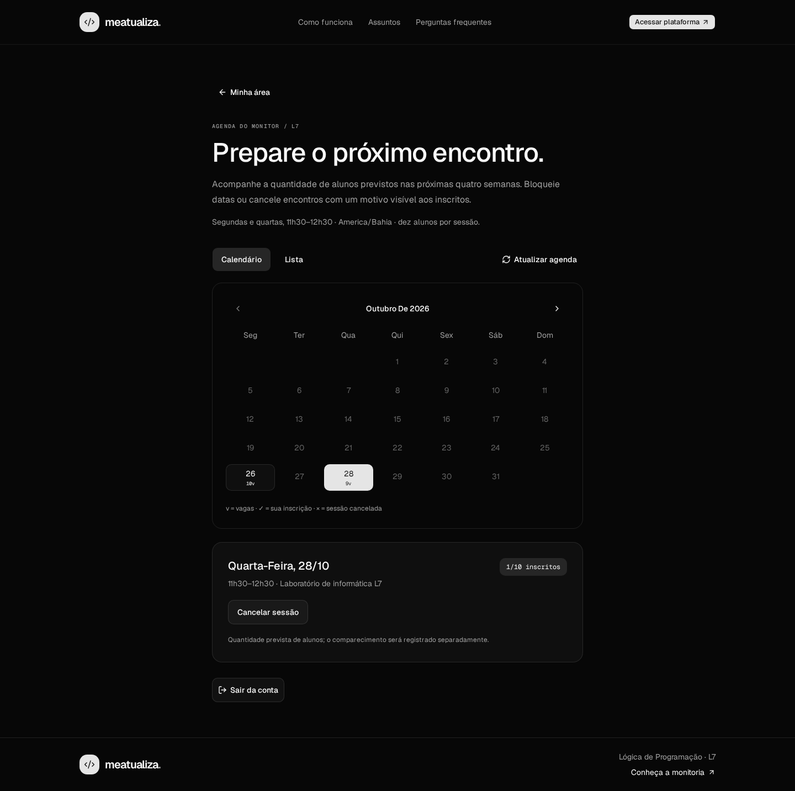

<div align="center">
  <h1>
    
    meatualiza
  </h1>
  <p>A group tutoring platform for Programming Logic at SENAI Dendezeiros.</p>
  
  <p><sub>Monitor agenda with sample data from local Firebase emulators.</sub></p>
</div>

## 📚 About

Meatualiza helps students explain their questions, choose a course topic, and book a group tutoring session. The monitor has a separate workspace to prepare meetings and track expected attendance. The application interface is in Brazilian Portuguese.

| Session details | Schedule                                                                                       |
| --------------- | ---------------------------------------------------------------------------------------------- |
| When            | Mondays and Wednesdays, 11:30–12:30, `America/Bahia`                                           |
| Where           | SENAI Dendezeiros, computer lab L7, Salvador, Brazil                                           |
| Format          | In person, 60 minutes, up to 10 students per session                                           |
| Booking window  | Next 28 days, within the term ending December 11, 2026; the last regular session is December 9 |

## ✨ Available features

- **Google sign-in:** any personal or institutional Google account can join. The server selects the student or monitor workspace.
- **Student dashboard:** upcoming confirmed registrations, saved questions, cancellation reasons, and direct links to the matching session in the agenda. Both workspaces have a responsive sidebar and an account menu for sign-out.
- **Student agenda:** responsive calendar and list views, automatic confirmation when a seat is available, and one active registration per student per session.
- **Help requests:** select a course topic, describe a question, review it, and save it with the registration. Editing the question does not reserve another seat.
- **Booking changes:** edit, cancel, or move a registration before the session starts. A failed move keeps the original registration.
- **Monitor workspace:** responsive sidebar, occupancy out of ten students, date blocking, and session cancellation with a reason visible to affected students.
- **Accessible interface:** dark theme, mobile navigation, keyboard controls, visible focus, loading states, and retryable errors.

[Sign-in preview](./docs/screenshots/auth-revamp-desktop.png) · [Student dashboard](./docs/screenshots/student-dashboard-desktop.png) · [Student agenda on mobile](./docs/screenshots/f4-agenda-aluno-mobile.png)

## 🧰 Stack

- Next.js 16 App Router, React 19, and TypeScript
- Tailwind CSS 4, shadcn/ui, Radix UI, and Lucide icons
- React Hook Form and Zod
- Firebase Authentication, Firestore, and the Firebase Admin SDK
- Playwright, Node.js test runner, and Firebase Local Emulator Suite
- ESLint, Prettier, Husky, lint-staged, and GitHub Actions

Resolved dependency versions are recorded in `package-lock.json`. Theme tokens and local Geist fonts live in `src/app`; Google artwork attribution is in [public/brand/README.md](./public/brand/README.md).

## 💻 Local development

Use **Node.js 24**, npm, and **Java 21 or newer** for the Firebase emulators. From a fresh checkout:

```bash
npm ci
cp .env.example .env.local
npm run emulators
```

In a second terminal:

```bash
npm run dev
```

Open <http://localhost:3000>. The example environment uses `demo-meatualiza`: sign-in runs through the Auth Emulator, and registrations are stored in the local Firestore emulator. No real Google account or cloud credential is needed. Both emulators must be running; their UI is disabled in `firebase.json`.

| Local service           | Address                 |
| ----------------------- | ----------------------- |
| Application             | `http://localhost:3000` |
| Authentication emulator | `127.0.0.1:9099`        |
| Firestore emulator      | `127.0.0.1:8080`        |

To preview a production build, run `npm run build` followed by `npm start`. The public pages can be previewed with the example environment; authenticated production flows require real Firebase configuration because emulator access is rejected in production.

## ⚙️ Configuration

Copy [.env.example](./.env.example) only on first setup; keep an existing `.env.local` when updating the checkout.

| Variable                             | Purpose                                                                               |
| ------------------------------------ | ------------------------------------------------------------------------------------- |
| `NEXT_PUBLIC_FIREBASE_API_KEY`       | Firebase browser app API key                                                          |
| `NEXT_PUBLIC_FIREBASE_AUTH_DOMAIN`   | Firebase Authentication domain                                                        |
| `NEXT_PUBLIC_FIREBASE_PROJECT_ID`    | Browser app project ID                                                                |
| `NEXT_PUBLIC_FIREBASE_APP_ID`        | Registered Firebase web app ID                                                        |
| `NEXT_PUBLIC_FIREBASE_USE_EMULATORS` | `true` for local emulators; `false` for real Firebase                                 |
| `FIREBASE_PROJECT_ID`                | Server project ID; must match the browser configuration                               |
| `FIREBASE_AUTH_EMULATOR_HOST`        | Local Auth host; remove for real Firebase                                             |
| `FIRESTORE_EMULATOR_HOST`            | Local Firestore host; remove for real Firebase                                        |
| `APP_ORIGIN`                         | Exact application origin used to validate authentication requests and booking actions |
| `GOOGLE_APPLICATION_CREDENTIALS`     | Optional path to a private ADC credential file, outside version control               |

### Real Firebase

1. Enable Google Authentication, register a web app, create the Firestore database, and apply the repository's [Firestore rules](./firestore.rules). Direct browser access to Firestore is denied; application data goes through authorized server operations.
2. Set the four public Firebase app values and the matching server project ID. Set `NEXT_PUBLIC_FIREBASE_USE_EMULATORS=false` and remove both emulator host variables.
3. Configure **Application Default Credentials (ADC)** for the Next.js server. Firebase CLI/MCP login and server credentials are separate. When using gcloud user credentials, Firebase Authentication requires your own OAuth **Desktop** client, as described in the [Admin SDK setup guide](https://firebase.google.com/docs/admin/setup#test-with-gcloud-end-user-credentials).
4. Set `APP_ORIGIN` to the actual origin, authorize the application domain in Firebase Authentication, and restart Next.js after environment changes. Public variables are included in the browser bundle at build time. Use HTTPS for deployed authentication.

For local user ADC, run this in the terminal on the machine running Next.js, replacing the file path:

```bash
gcloud auth application-default login \
  --client-id-file="/path/to/oauth-desktop-client.json"
```

Keep `.env.local`, ADC files, tokens, and session cookies private. Administrative credentials must never use a `NEXT_PUBLIC_` variable. Deployment is tracked separately in the roadmap.

### Monitor access

All new Google users enter as students. Monitor access is granted through a trusted administrative command, using the existing Google user's Firebase Authentication UID. Run against the intended project with working server credentials, or its local emulators.

Grant access, replacing `USER_UID`:

```bash
npm run monitor:access -- grant USER_UID
```

The user must sign out and sign in again to obtain a session with the new privilege. To remove access instead:

```bash
npm run monitor:access -- revoke USER_UID
```

The commands preserve other custom claims. Revocation also invalidates existing sessions. Role selection is never exposed in the sign-in UI; protected reads and mutations verify identity and authorization on the server.

### Access troubleshooting

| Symptom                                             | What to check                                                                                                                                                                                      |
| --------------------------------------------------- | -------------------------------------------------------------------------------------------------------------------------------------------------------------------------------------------------- |
| `POST /api/auth/session` returns `401`              | Keep the server clock synchronized with NTP; check the Firebase project and sign in again. The ID token must come from authentication within the last five minutes.                                |
| Session creation returns `503`                      | Check server ADC and Firebase connectivity. An OAuth `invalid_grant` during credential refresh requires renewing the server authorization; signing into the Firebase CLI alone does not renew ADC. |
| A newly granted monitor still sees the student area | Sign out and sign in again after granting the claim.                                                                                                                                               |
| A profile document was deleted from Firestore       | A successful sign-in recreates the profile. The monitor claim belongs to Firebase Authentication and is not removed by deleting the profile document.                                              |

Sessions use five-day `HttpOnly` cookies with `SameSite=Lax`, and `Secure` in production. Logout clears the current browser session. Browser Firebase tokens are kept in memory rather than persistent local storage.

## ✅ Validation

Run the checks sequentially. The browser tests require an existing production build and Chromium:

```bash
npm run format:check
npm run lint
npm run typecheck
npm run test:domain
npm run test:firebase
npm run build
npx playwright install chromium
npm test
npm run test:auth
```

- `test:domain` checks scheduling rules and help-request contracts.
- `test:firebase` starts Auth/Firestore emulators and checks authorization, ownership, transactions, capacity races, and retries.
- `npm test` runs the production landing/access browser suite on port `3100`, including keyboard navigation, image loading, and responsive layouts.
- `test:auth` starts the emulators and a separate development server on port `3101` for Google popup, session, role, and booking flows. Tests use fictitious accounts; captures and traces go to `test-results/`.

Do not run the emulator suites or the build/browser checks concurrently: they share ports or build output. The [CI workflow](./.github/workflows/ci.yml) runs these checks on pull requests and pushes to `main`. GitHub billing-related CI blocks do not replace the requirement to pass local checks.

`npm run format` formats the project. Pre-commit hooks run ESLint and Prettier on staged files.

## 🗂️ Structure

```text
src/
├── app/                 # routes, layouts, auth endpoints, theme, and local fonts
├── components/          # shared brand, navigation, and UI primitives
├── features/            # landing, authentication, help requests, workspace shell, agenda
└── lib/                 # domain rules, validation, authorization, and Firebase clients
tests/                   # domain, Firebase/server, and browser suites
scripts/                 # trusted monitor access commands
docs/screenshots/        # committed desktop and mobile previews
```

## 📌 Roadmap and documentation

Current delivery: F5.1b, the student dashboard and navigation. The dashboard uses the agenda's next-28-days window; past-session history is not included yet. Next: participant and question lists for the monitor, attendance, completed sessions, student-reported question resolution, and dashboard metrics. Guided tours, privacy preferences, PostHog Surveys, Sentry, and analytics are planned; they are not active integrations in this release.

- [Roadmap and task board](./ROADMAP.md)
- [Project requirements](./INSTRUCTIONS.md) and [domain glossary](./GLOSSARY.md)
- [Firebase and access plan](./PLANO-F2.md)
- [Help-request plan](./PLANO-F3.md) and [scheduling/booking plan](./PLANO-F4.md)
